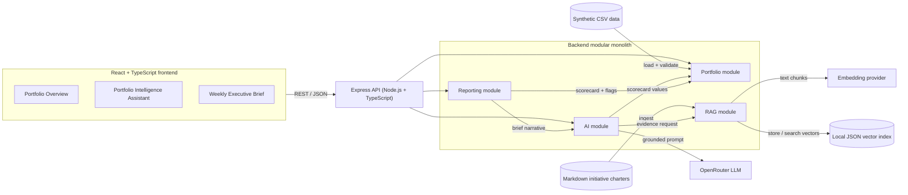
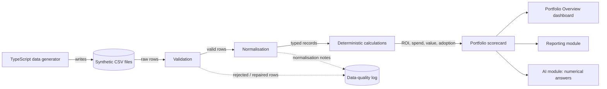
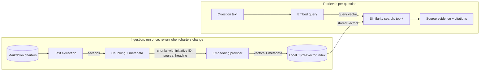
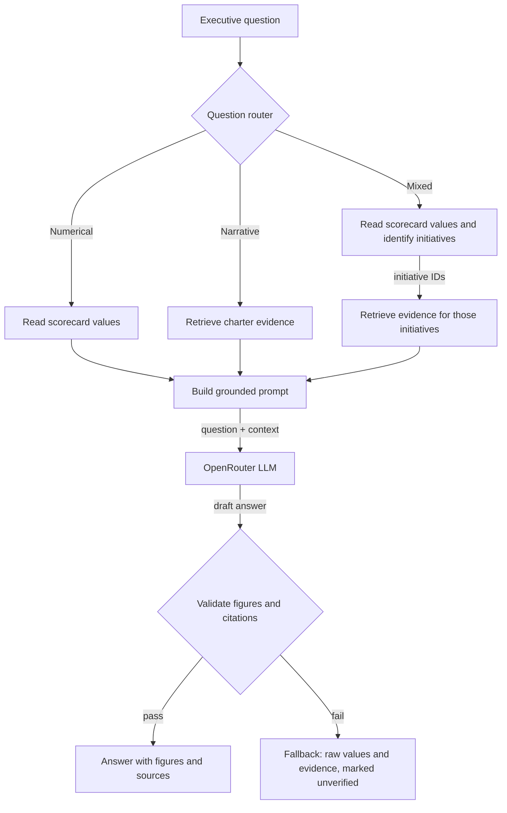
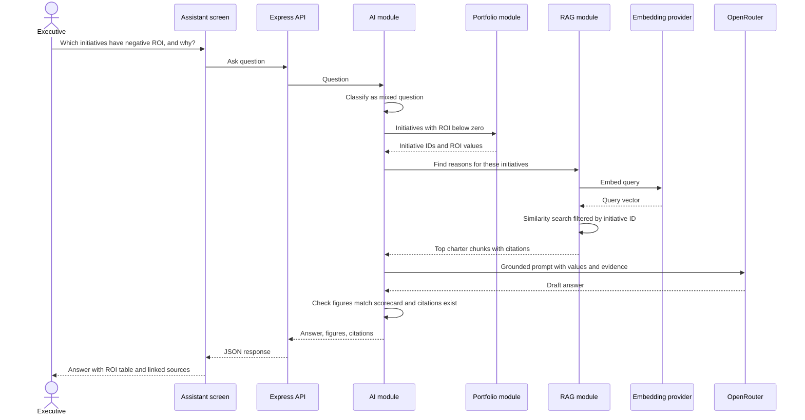

# AI Portfolio Command Centre — Architecture

**An Enterprise RAG Value Intelligence Assistant** that helps executives understand how AI initiatives are performing. It combines **structured portfolio metrics** (synthetic CSV data) with **unstructured initiative charters** (Markdown).

> Status: architecture agreed, implementation not started.
> The standalone diagram sources are in [`docs/diagrams/`](diagrams/).

---

## 1. Guiding principles

| Principle | What it means for us |
|---|---|
| **Modular monolith** | One Express app and one deployable unit. Four modules with clear boundaries. No microservices, queues or external databases. |
| **Numbers come from code, not the LLM** | Every metric (ROI, spend, value, adoption) is calculated deterministically in TypeScript. The LLM only explains values it is given. |
| **Every claim is traceable** | Answers carry scorecard figures and charter citations (initiative ID, file, section). |
| **Validate before showing** | Generated answers are checked against the scorecard and the retrieved evidence before they reach the UI. |
| **Simplest storage that works** | We start with a local JSON vector index. We move to something else only if the feasibility check fails. |
| **One language** | TypeScript end to end: frontend, backend and data-generation scripts. No Python. |

## 2. Technology stack

| Layer | Choice |
|---|---|
| Frontend | React + TypeScript, Tailwind CSS, Recharts |
| Backend | Node.js + Express + TypeScript |
| Structured data | Synthetic CSV, generated by TypeScript scripts |
| Unstructured data | Markdown initiative charters |
| LLM | Claude (`claude-sonnet-5-5`) via the Anthropic API (official SDK); OpenRouter as configured alternative |
| Embeddings | `openai/text-embedding-3-small` via OpenRouter (verified; the Anthropic API has no embeddings endpoint) |
| Vector storage | Local JSON vector index (subject to the feasibility check in §8) |
| Version control | GitHub |

---

## 3. Overall system architecture

The frontend has three screens and talks to a single Express API. The API delegates to four backend modules:

- **Portfolio** owns structured data.
- **RAG** owns charter documents and vectors.
- **AI** is the only module that calls the LLM. It combines Portfolio and RAG outputs to answer questions.
- **Reporting** builds attention flags and the weekly brief from the scorecard, and asks the AI module for the narrative.

### Module responsibilities

| Module | Responsibilities | Depends on |
|---|---|---|
| **Portfolio** | Load synthetic CSV, validate and normalise rows, calculate metrics deterministically, produce the portfolio scorecard, maintain the data-quality log | — |
| **RAG** | Read Markdown charters, extract and chunk text, generate embeddings, store and retrieve vectors, keep source and initiative metadata, return evidence with citations | Embedding provider |
| **AI** | Receive questions, route them (numerical / narrative / mixed), gather scorecard values and/or evidence, build prompts, call OpenRouter, validate the response and its evidence | Portfolio, RAG, OpenRouter |
| **Reporting** | Generate portfolio attention flags, prepare the weekly executive brief | Portfolio, AI |

**Boundary rule:** modules talk to each other only through their exported service interfaces, never through each other's internal files. Only the RAG module talks to the embedding provider. Only the AI module talks to OpenRouter.

### Frontend screens

| Screen | Backed by |
|---|---|
| Portfolio Overview | Portfolio module (scorecard, charts, data-quality summary) |
| Portfolio Intelligence Assistant | AI module (questions, answers, citations) |
| Weekly Executive Brief | Reporting module (attention flags, brief) |

---

## 4. Structured-data flow

Synthetic CSV goes through validation and normalisation before any calculation. Rows that are rejected or repaired are written to the **data-quality log**, so data problems show up instead of being hidden. The resulting **scorecard** is the single source of truth for every number in the dashboard, the brief and assistant answers.

---

## 5. RAG ingestion and retrieval flow

**Ingestion** runs once, and again whenever the charters change. Each chunk keeps its **initiative ID, source file and section heading**. That lets retrieval filter by initiative and lets answers cite exact sources.

**Retrieval** embeds the question with the same model and returns the top-k most similar chunks as evidence.

---

## 6. Question-answering flow

The AI module sorts each question into one of three types:

| Type | Example | Context used |
|---|---|---|
| **Numerical** | "What is total portfolio spend this quarter?" | Scorecard values only |
| **Narrative** | "What problem is the claims-triage initiative solving?" | Charter evidence only |
| **Mixed** | "Which initiatives have negative ROI, and why?" | Scorecard values first, then charter evidence filtered to those initiatives |

For mixed questions, the structured data decides **which** initiatives are relevant. The charters explain **why**. After the LLM drafts an answer, a validation step checks that every figure matches the scorecard and every citation points to a retrieved chunk. If validation fails, the user sees the raw values and evidence, clearly marked as unverified.

---

## 7. Request lifecycle: a mixed question

> *"Which initiatives have negative ROI, and what are the reasons behind their performance?"*

---

## 8. Open decisions and checks

| Item | Status | Exit criterion |
|---|---|---|
| Embedding provider/model | To verify | Confirm API access, vector dimensions, cost and rate limits with a single test call |
| JSON vector index feasibility | To verify | Load the full chunk set and run brute-force cosine search in under ~200 ms. If it fails, switch to an embedded vector library. Still no external service. |
| OpenRouter model choice | To decide | Pick one default model and one fallback. Confirm structured-output support. |
| Question router approach | To decide | Start with rules (keywords plus known metric names). Add LLM classification only if accuracy is poor. |

## 9. Diagram sources

| Diagram | File |
|---|---|
| A. Overall system architecture | [`diagrams/01-system-architecture.mmd`](diagrams/01-system-architecture.mmd) |
| B. Structured-data flow | [`diagrams/02-structured-data-flow.mmd`](diagrams/02-structured-data-flow.mmd) |
| C. RAG ingestion and retrieval | [`diagrams/03-rag-flow.mmd`](diagrams/03-rag-flow.mmd) |
| D. Question-answering flow | [`diagrams/04-question-answering-flow.mmd`](diagrams/04-question-answering-flow.mmd) |
| E. Sequence: negative-ROI question | [`diagrams/05-sequence-negative-roi.mmd`](diagrams/05-sequence-negative-roi.mmd) |

The `.mmd` files and the blocks embedded above must stay identical. Edit the `.mmd` file first, then copy it into this document.
