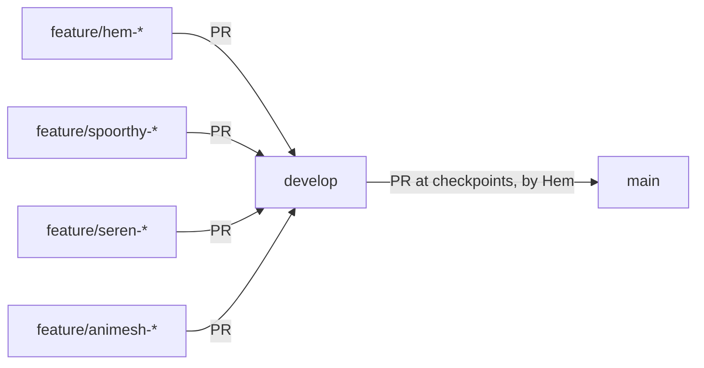

# Team Git Workflow

A lightweight workflow for a six-hour build. The goal is to **merge small pieces often**, so integration problems show up early instead of at the end.

---

## 1. Branches



| Branch | Purpose | Who writes to it |
|---|---|---|
| `main` | Last known **demo-ready** version | Hem only, by PR from `develop` at checkpoints |
| `develop` | Integration branch; everyone's finished work | PRs only, merged by Hem (or any reviewer Hem names) |
| `feature/<member>-<topic>` | One focused piece of work | The member who owns it |

**Rules**

- **No direct pushes to `main` or `develop`.** Everything goes through a pull request. Hem enables branch protection on GitHub for both.
- Pull requests target **`develop`**, never `main`.
- One feature branch = one focused change. Prefer two small PRs over one big one.
- Delete the feature branch after it is merged. Start the next task from a fresh `develop`.

## 2. Each member's feature branches

| Member | Suggested branches, in order |
|---|---|
| Hem | `feature/hem-scaffold`, `feature/hem-rag-ingestion`, `feature/hem-rag-retrieval`, `feature/hem-ai-assistant` |
| Spoorthy | `feature/spoorthy-synthetic-data`, `feature/spoorthy-charters`, `feature/spoorthy-portfolio-metrics` |
| Seren | `feature/seren-client-shell`, `feature/seren-overview`, `feature/seren-assistant-ui`, `feature/seren-weekly-brief` |
| Animesh | `feature/animesh-eval-set`, `feature/animesh-reporting`, `feature/animesh-tests` |

Pattern: `feature/<member>-<short-topic>`, lowercase, hyphens only.

## 3. One-time setup (Hem, before the build starts)

These are **not done yet**. Hem runs them once:

1. Create the GitHub repository and give the team write access.
2. In a **standalone** project folder (its own `.git`, not inside another repository): commit the docs to `main`, then create `develop` from `main` and push both.
3. On GitHub, protect `main` and `develop`: require a pull request before merging.
4. Each member clones:

```bash
git clone <repo-url>
cd <repo-folder>
git checkout develop
```

## 4. Daily loop

### Start a task

```bash
git checkout develop
git pull origin develop
git checkout -b feature/<member>-<topic>
```

### While working

```bash
git status                     # check you only changed files you own
git add <your files>           # add specific paths, not "git add ." blindly
git commit -m "portfolio: add ROI calculation and tests"
git push -u origin feature/<member>-<topic>
```

### Keep up to date with `develop` (do this at least every hour, and before opening a PR)

```bash
git fetch origin
git merge origin/develop       # merge, don't rebase: simpler and safer for this team
```

Then run typecheck and tests again.

### Open a pull request

1. Push your branch.
2. On GitHub, open a PR: **base `develop` ← compare `feature/<member>-<topic>`**.
3. Use this description:

```markdown
## What
<one or two sentences>

## Files
<owned folders touched; anything outside your ownership and who approved it>

## How I tested
- [ ] npm run typecheck
- [ ] npm test
- [ ] Manual check: <curl command or screen>

## Contract changes
None / <link to the api-contracts.md change>

## Needs from others
None / <who, what>
```

4. Post the PR link in the team chat with `@` the reviewer.

## 5. Requesting integration and review

| PR type | Reviewer |
|---|---|
| Any PR | Hem (Tech Lead) merges. If Hem is busy, Hem names a stand-in. |
| Portfolio data / metrics | + Animesh (checks numbers against tests) |
| Client changes using a new endpoint | + owner of that endpoint's service |
| Contract change (`docs/api-contracts.md`) | Hem + every member whose code uses that shape |

- Review within about **15 minutes** during the build. If blocked longer, say so in chat.
- The reviewer checks that the PR touches only owned files, tests pass, and shapes match the contract. Style nitpicks are optional.
- **Integration checkpoints** (Hem merges `develop` → `main` after each one works end to end):
  - **Checkpoint 1, about hour 1:** scaffold + mock endpoints. Client shows mock data.
  - **Checkpoint 2, about hour 3:** real Portfolio data on the dashboard.
  - **Checkpoint 3, about hour 4.5:** real assistant answers with citations; weekly brief renders.
  - **Feature freeze, about hour 5:** bug fixes and demo polish only.

## 6. Handling conflicts safely

Conflicts should be rare because everyone owns different folders. When one happens:

1. **Do not panic and do not force-push.** Never use `git push --force` on a shared branch, and never use `git reset --hard` unless you understand exactly what you lose.
2. Run `git status` to see the conflicted files.
3. **If the file is yours:** open it, keep the correct parts from both sides, and remove the `<<<<<<<`, `=======`, `>>>>>>>` markers. Then:

   ```bash
   git add <file>
   git commit                      # completes the merge
   npm run typecheck && npm test
   ```

4. **If the file is not yours** (for example a shared route or `package.json`): stop. Run `git merge --abort` to go back to where you were, and ask the owner (or Hem) in chat. Do not "fix" someone else's file.
5. **Lockfile conflicts** (`package-lock.json`): take the `develop` version (`git checkout --theirs package-lock.json`), then run `npm install` and commit the regenerated lockfile.
6. If you are unsure, ask Claude: *"I have a merge conflict, help me resolve it safely without touching files I don't own."*

## 7. What never to commit

`.env`, `node_modules/`, `server/storage/` (generated vector index), `dist/` / build output, editor and OS files. Hem adds these to `.gitignore` during scaffolding.
